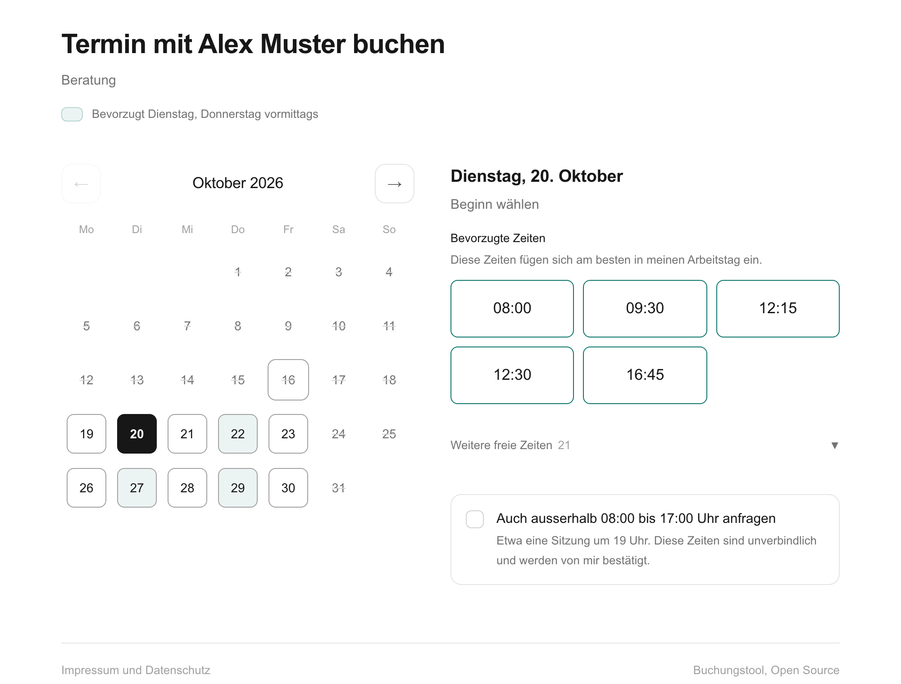

# Buchungstool

[English version](README.en.md) · [CI](https://github.com/Villagio88/buchungstool/actions) · Lizenz AGPL-3.0

Eine selbst gehostete Seite für Terminbuchungen, die die Verfügbarkeit aus **mehreren
Kalendern verschiedener Anbieter zugleich** liest, über deren ICS-Links. Ohne Konto bei
einem Buchungsdienst, ohne Zugriff auf Postfächer, mit Daten auf dem eigenen Server.



## Wofür es gedacht ist

Für Leute, deren Termine in Kalendern liegen, die sich nicht miteinander verbinden lassen:
privat Proton Calendar, geschäftlich Microsoft 365, dazu vielleicht ein Kalender einer
Schule oder eines Vereins. Die bekannten Buchungsdienste (Calendly, TidyCal, Microsoft
Bookings) verbinden sich per Anmeldung mit Google, Microsoft oder Apple, Bookings nur
mit dem eigenen Microsoft 365. Proton bietet
weder CalDAV noch eine API, und viele Organisationen erlauben keine Verbindung eines
fremden Dienstes mit ihrem Microsoft-365-Konto.

Fast jeder Kalender lässt sich aber als **ICS-Link** freigeben, oft auch nur mit «belegt».
Das Buchungstool liest beliebig viele solcher Links und bietet eine Zeit nur an, wenn sie
in allen frei ist. Gäste sehen ausschliesslich frei oder belegt; Titel, Orte und
Teilnehmer verlassen den Server nie.

### Ehrliche Einordnung

Die Idee ist nicht einzigartig, und das soll niemand erst nach der Installation merken:

| Werkzeug | ICS-Links als Quelle | Selbst hosten | Lizenz | Unterschied |
|---|---|---|---|---|
| **Buchungstool** | ja, beliebig viele | ja (Docker) | AGPL-3.0 | klein, eine Person, mehrere Rollen mit eigener Zieladresse, keine Konten |
| [Tymeslot](https://tymeslot.app) | ja, laut [Funktionsliste](https://tymeslot.app/features) («feed URL») | ja (Docker), auch gehostet | AGPL-3.0 | grösserer Funktionsumfang, Benutzerkonten |
| [Cal.diy](https://github.com/calcom/cal.diy) (Community-Fassung von Cal.com) | ja, App «ICS Feed» | ja, aufwendig | MIT | sehr umfangreich, für Teams; Selbsthosten aufwendig |
| [Proton Booking Pages](https://proton.me/support/calendar-appointment-scheduling) | Proton-Kalender | nein | proprietär | seit April 2026 in Proton enthalten; ideal, wenn alles in Proton liegt |
| Calendly, TidyCal | nein (Anmeldung bei Google, Microsoft, Apple) | nein | proprietär | ausgereift, aber ohne Proton und mit Daten beim Anbieter |
| Microsoft Bookings | nein (nur der eigene Microsoft-365-Kalender) | nein | proprietär | in Microsoft 365 enthalten, nur innerhalb der eigenen Organisation |

Stand Oktober 2026, ohne Gewähr. Wer nur Proton nutzt, ist mit Protons Buchungsseiten
besser bedient. Wer viele Funktionen und Konten braucht, mit Tymeslot. Das Buchungstool
ist für den Fall gebaut, dass **eine Person** Termine über **mehrere Anbieter hinweg**
anbieten will und dabei möglichst wenig Software betreiben möchte.

## Was es kann

- **Verfügbarkeit aus beliebig vielen ICS-Kalendern**, mit Serien, Zeitzonen (auch die
  Windows-Namen von Outlook), ganztägigen Einträgen und als «frei» markierten Terminen.
- **Mindestabstand je Kalender**, etwa 30 Minuten zu privaten Terminen mit Anfahrt und
  5 Minuten zu Besprechungen im Haus.
- **Bereiche** mit eigener Zieladresse, etwa «Beratung» an die Geschäftsadresse und
  «Privat» an die private, damit die Einladung im richtigen Kalender landet. Jeder Bereich
  hat einen kurzen Link (`/beratung`), eine Akzentfarbe und auf Wunsch ein Logo, und lässt
  sich aus der öffentlichen Auswahl ausblenden.
- **Freie Dauer**: der Gast wählt Tag, Beginn und Ende; angeboten wird nur, was hineinpasst.
- **Empfohlene Zeiten**, die den Tag nicht zerstückeln, und ein **Wochenmuster** je Bereich.
- **Randzeiten auf Anfrage** über `?anfrage=1`, deutlich markiert.
- **Echte Kalendereinladung** (ICS) an den Inhaber und an den Gast, über ein beliebiges
  SMTP-Konto; Zeiten in UTC, damit sie in jeder Zeitzone stimmen.
- **Absage per Link**, je ein eigener Link für Gast und Inhaber; der Termin verschwindet
  dank `METHOD:CANCEL` von selbst aus beiden Kalendern.
- **Keine Doppelbuchung**: jede Buchung belegt Fünf-Minuten-Einheiten mit eindeutigem
  Schlüssel; ist ein Kalender nicht erreichbar, wird nicht gebucht.
- **Datensparsam**: IP-Adressen werden nach 7 Tagen gelöscht, Name, Mail, Ort und Anliegen
  90 Tage nach dem Termin (beides einstellbar). Keine Cookies, keine fremden Skripte oder
  Schriften, keine Statistik. Impressum und Datenschutzerklärung entstehen aus der
  Konfiguration.
- **Missbrauchsschutz**: Grenzen je Mailadresse und IP, verstecktes Feld gegen Bots,
  Bereinigung aller Eingaben, Sicherheitskopfzeilen (CSP, HSTS).

## Schnellstart mit Docker

```bash
git clone https://github.com/Villagio88/buchungstool.git
cd buchungstool
cp buchung.env.example buchung.env      # ausfüllen: Kalender, Bereiche, SMTP, Impressum
docker compose up -d --build
curl http://127.0.0.1:3000/gesund        # {"ok":true,...}
```

Statt selbst zu bauen, geht auch das fertige Abbild `ghcr.io/villagio88/buchungstool`
(siehe `docker-compose.yml`). Für den Betrieb im Netz gehört ein Reverse Proxy mit HTTPS
davor, etwa Caddy:

```
termin.example.com {
    reverse_proxy 127.0.0.1:3000
}
```

Änderungen an `buchung.env` brauchen keinen neuen Build, `docker compose up -d` genügt.
Die Datenbank (SQLite) liegt im Volume `buchung_data`. Für eine Sicherung im laufenden
Betrieb eine konsistente Kopie erzeugen lassen und direkt auf den Host schreiben (die
Datei allein zu kopieren reicht nicht, weil SQLite neue Daten zuerst in eine Nebendatei
schreibt). Im Container bleibt dabei keine Kopie zurück:

```bash
docker compose exec -T buchung node -e "const {DatabaseSync}=require('node:sqlite'),fs=require('node:fs');const z='/tmp/s-'+Date.now()+'.db';new DatabaseSync('/data/buchung.db').exec(\"VACUUM INTO '\"+z+\"'\");process.stdout.write(fs.readFileSync(z));fs.unlinkSync(z)" > sicherung-$(date +%F).db
```

Sicherungen enthalten Personendaten und unterliegen denselben Löschfristen; alte
Sicherungen deshalb nicht unbegrenzt aufbewahren.

## ICS-Links finden

- **Proton Calendar**: Einstellungen, Kalender, «Teilen», «Link erstellen», Option
  «Limited view» (nur belegt). Nur in bezahlten Plänen. Proton aktualisiert den Link
  laut eigener Angabe mit bis zu acht Stunden Verzögerung.
- **Microsoft 365 / Outlook im Web**: Einstellungen, Kalender, Freigegebene Kalender,
  «Kalender veröffentlichen», Berechtigung «Kann anzeigen, wann ich beschäftigt bin»,
  ICS-Link kopieren.
- **Google Kalender**: Einstellungen des Kalenders, «Privatadresse im iCal-Format».
- **iCloud**: Kalender als «Öffentlicher Kalender» freigeben, `webcal://` durch
  `https://` ersetzen.

Diese Links sind Geheimnisse: wer sie hat, kann den Kalender lesen. Sie gehören nur in
`buchung.env`. Gelangt ein Link nach aussen, beim Anbieter einen neuen erzeugen.

Wegen der Verzögerungen der Anbieter gibt es einen Vorlauf (`VORLAUF_STUNDEN`, Standard
12): kurzfristig Eingetragenes ist so meist schon im Feed, bevor jemand die Zeit buchen
kann. Ob ein Feed aktuell ist, zeigt ein Testeintrag.

## Für Schulen und Organisationen

- **Prüfen, ob Veröffentlichen erlaubt ist.** Microsoft 365 und Google Workspace lassen
  das Veröffentlichen von Kalendern per Richtlinie sperren; in Schulen kommt das vor.
  Fehlt die Option, entscheidet die IT, nicht das Buchungstool.
- **Nur «belegt» freigeben.** Für das Buchungstool genügt die Stufe ohne Details, und sie
  schützt Schüler- und Elterndaten, falls ein Link doch nach aussen gelangt.
- **Datenschutz.** Betrieb auf eigenem Server in der Schweiz oder der EU, Versand über
  einen Mailanbieter im selben Raum, Löschfristen gemäss eigener Vorgabe einstellen.
  Die Datenschutzseite nennt Zweck, gespeicherte Daten und Fristen; Verantwortliche und
  Mailanbieter (`DATENSCHUTZ_MAILDIENST`) müssen eingetragen werden. Bei Versand über
  einen Anbieter ausserhalb der Schweiz verlangt das revDSG (Art. 19) die Nennung des
  Staates. Keine Rechtsberatung.
- **Wer betreibt es?** Das Buchungstool hat keine Benutzerverwaltung und keine Übersicht
  der Buchungen. Massgeblich sind die Einladungen im eigenen Kalender. Für mehrere
  Lehrpersonen braucht es je eine eigene Installation oder ein anderes Werkzeug.

## Konfiguration

Alle Einstellungen stehen kommentiert in [`buchung.env.example`](buchung.env.example).

| Variable | Bedeutung |
|---|---|
| `INHABER_NAME` | Name im Titel, in den Einladungen und als Unterschrift |
| `SEITEN_URL` | Öffentliche Adresse der Seite, für die Absage-Links (Pflicht) |
| `KALENDER` | Namen der Kalender; je Name `KALENDER_<NAME>_URL` und optional `_PUFFER` |
| `BEREICHE` | Namen der Bereiche; je Name `BEREICH_<NAME>_NAME`, `_MAIL`, `_HINWEIS`, `_AKZENT`, `_LOGO`, `_WUNSCHZEITEN` |
| `BEREICHE_OEFFENTLICH` | Bereiche, die ohne eigenen Link zur Auswahl stehen |
| `VON_UHR`, `BIS_UHR`, `ARBEITSTAGE`, `TZ` | Bürozeit, Wochentage, Zeitzone |
| `KALENDER_IGNORIEREN` | Titel, die nie blockieren, etwa `Ferien,Stand-up` |
| `MAIL_SMTP_HOST`, `MAIL_SMTP_PORT`, `MAIL_USER`, `MAIL_PASS` | Versand der Einladungen |
| `LOESCHEN_IP_NACH_TAGEN`, `LOESCHEN_PERSONENDATEN_NACH_TAGEN` | Löschfristen |

## Betrieb

- `GET /gesund` meldet Datenbank und Erreichbarkeit der Kalender, nur als Zahlen. Das
  Docker-Abbild nutzt es als Healthcheck.
- Ein Ausfall eines Kalenders sperrt das Buchen, bis er wieder erreichbar ist, statt
  Zeiten anzubieten, die vielleicht belegt sind.
- Updates: neues Abbild ziehen oder neu bauen, `docker compose up -d`. Fehlende Spalten
  ergänzt die Seite beim ersten Zugriff auf die Datenbank; vorhandene Daten bleiben.
  Vorher eine Sicherung anlegen (siehe oben).
- Der Container startet kurz als root, übergibt das Datenverzeichnis dem Benutzer
  `node` und läuft dann als `node`. So funktionieren auch Volumes älterer Fassungen.

## Entwicklung

```bash
npm ci
cp buchung.env.example .env.local        # ausfüllen; next dev liest .env.local
npm run dev
npm test                                  # Zeitberechnung, Kalender, Einladungen, Datenbank
npm run sicherheit                        # Gästeeingaben gegen die Kalendereinladung
```

Aufbau: Next.js (App Router) mit Server Actions, SQLite über das in Node 24 eingebaute
`node:sqlite`, `ical.js` zum Lesen der Feeds, `nodemailer` für den Versand. Die
Zeitberechnung in `lib/slots.ts` ist frei von Ein- und Ausgabe und mit Tests abgedeckt.
Bezeichner und Kommentare sind Deutsch, siehe [CONTRIBUTING.md](CONTRIBUTING.md).

## Grenzen

- Die Oberfläche ist Deutsch.
- Keine Übersicht der Buchungen für den Inhaber und keine Benutzerverwaltung.
- Keine Videokonferenz-Links; den Ort (auch «online») gibt der Gast an.
- Die Verfügbarkeit ist nur so aktuell wie die Feeds der Anbieter.
- Die Sperre je IP-Adresse setzt genau einen Reverse Proxy voraus, der
  `X-Forwarded-For` ergänzt.

## Sicherheit und Lizenz

Lücken bitte nicht öffentlich melden, sondern wie in [SECURITY.md](SECURITY.md)
beschrieben. Lizenz: [GNU Affero General Public License v3.0](LICENSE). Wer das
Buchungstool verändert und als Dienst für andere betreibt, muss den geänderten Quellcode
ebenfalls zugänglich machen.

Entstanden mit Unterstützung von KI (Claude). Die Logik ist mit automatischen Tests
abgesichert, die bei jeder Änderung in GitHub Actions laufen.
